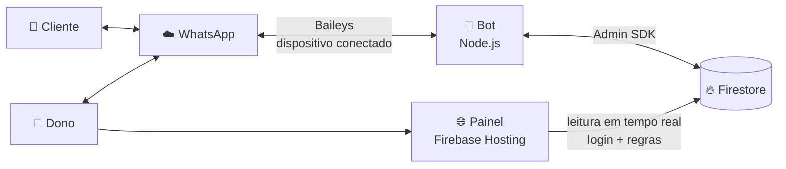
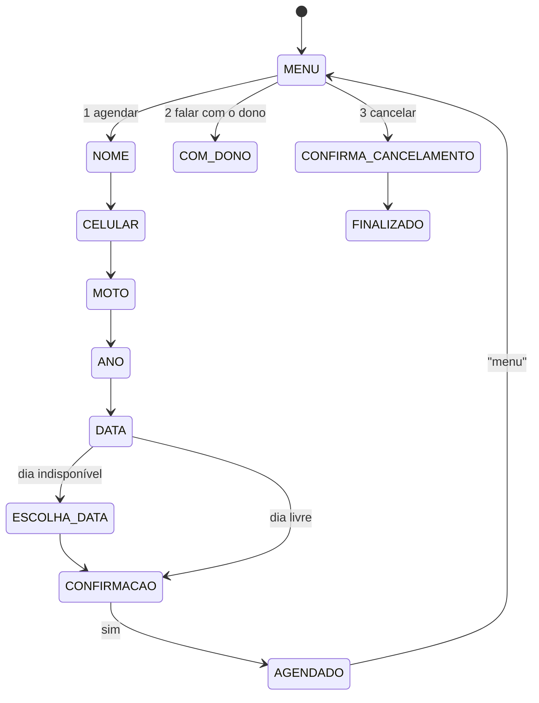

<p align="center">
  
</p>

<h1 align="center">Dinei Motos — Chatbot de agendamento de revisões</h1>

<p align="center">
  Bot de WhatsApp que agenda revisões de motos sozinho, com menu de administração para o dono
  e um painel web com o calendário em tempo real.
</p>

<p align="center">
  
  
  
  
</p>

---

## O problema

A oficina faz **uma revisão por dia, de terça a sexta**, e os agendamentos chegavam todos pelo WhatsApp,
misturados com o resto das conversas. O dono precisava responder um por um, conferir a agenda de cabeça
e lembrar os clientes na véspera.

## A solução

Um bot conectado ao WhatsApp da oficina que:

- **atende o cliente** na hora: coleta nome, celular, moto e ano, entende a data escrita do jeito da pessoa
  (`20/10`, `terça que vem`, `dia 2 do 2`, `em março`, `próxima vaga`) e sugere outros dias quando a data não está livre;
- **garante uma revisão por dia**, mesmo com vários clientes tentando o mesmo dia ao mesmo tempo;
- **lembra** o dono e o cliente às 18h da véspera;
- **passa o atendimento para o dono** quando o cliente pede ou quando o bot não entende;
- dá ao dono um **menu de administração** dentro do próprio WhatsApp;
- alimenta um **painel web** com o calendário, para o dono ver a agenda pelo celular.

---

## Funcionalidades

### Para o cliente
| | |
|---|---|
| 📅 **Agendar** | 5 perguntas, resumo e confirmação antes de gravar |
| 🗓️ **Datas em linguagem natural** | Entende várias formas de escrever datas; se o dia estiver ocupado, oferece a mais próxima e outras para frente |
| ❌ **Cancelar** | Pelo próprio número do WhatsApp, com até 3 dias de antecedência |
| 💬 **Falar com o dono** | O bot sai da conversa e avisa o dono |
| 🤝 **Atendimento humano automático** | No menu, 2 mensagens seguidas que o bot não entende (ou áudios) → o dono é chamado |

### Para o dono (menu no WhatsApp)
| | |
|---|---|
| 📋 **Ver agenda** | Próximos dias ocupados e bloqueados |
| 🚫 **Bloquear / desbloquear** | Um dia (`bloquear 25/12 Natal`) ou um período (`bloquear 15 a 22/12 férias`), com confirmação |
| ❌ **Cancelar revisão** | O cliente é avisado automaticamente |
| ➕ **Agendar para um cliente** | Mostra os próximos dias livres; o cliente recebe a confirmação no WhatsApp |

### Automático
| | |
|---|---|
| 🔔 **Lembrete às 18h** | Para o dono e para o cliente, nunca duplicado |
| 🔔 **Avisos** | Cliente cancelou, cliente quer falar com o dono, não foi possível avisar um cliente |
| 🧹 **Limpeza diária** | Mantém só os últimos 30 dias de histórico |

### Painel web
Calendário mensal com cores (livre, revisão, bloqueado, fechado), detalhes do dia com botões para chamar o
cliente no WhatsApp ou ligar, lista das próximas revisões, atualização em tempo real, login com usuário e senha,
modo escuro e instalação na tela inicial do celular.

---

## Arquitetura



### Como o bot decide o que responder

A conversa é uma **máquina de estados**: a etapa de cada cliente fica salva no banco, então o bot sabe
o que cada mensagem está respondendo (e continua de onde parou mesmo se reiniciar). Dentro de cada etapa,
regras e expressões regulares interpretam o texto.



### Decisões técnicas

- **Uma revisão por dia, mesmo com concorrência:** a reserva usa uma **transação** do Firestore
  (lê o dia e grava a reserva de forma atômica). Testado com 15 clientes disputando as mesmas datas ao mesmo tempo.
- **Vários clientes ao mesmo tempo:** cada conversa tem a sua fila (mensagens de um cliente são tratadas em ordem)
  e as conversas andam em paralelo; só o envio final passa por uma fila global com intervalo mínimo.
- **Comportamento de atendimento humano:** marca como lida, mostra "digitando...", ignora grupos, status,
  mensagens antigas e repetidas, e limita respostas por conversa (evita loop com outros robôs).
- **Lembrete sem duplicar:** a revisão é marcada como "lembrete enviado" numa transação **antes** do envio.
- **Números brasileiros:** o WhatsApp às vezes identifica celulares sem o 9 após o DDD; as buscas consideram as duas formas.
- **Segurança do painel:** as regras do Firestore deixam tudo fechado e liberam **apenas leitura** para a conta do dono;
  todo texto vindo do banco é escapado antes de ir para a página.
- **Proteções ao ligar:** o bot não inicia duas vezes no mesmo computador e exige modo de teste
  ou autorização explícita para responder a todos os contatos.

---

## Estrutura

```
├── src/
│   ├── conexao.js      # conexão com o WhatsApp, filas, envio, relógio de tarefas
│   ├── bot.js          # máquina de estados do atendimento ao cliente
│   ├── chefe.js        # menu de administração do dono
│   ├── agenda.js       # regras da agenda: dias livres, reserva, cancelamento, bloqueios
│   ├── texto-data.js   # interpretação de datas em linguagem natural
│   ├── validacao.js    # nome, celular, ano, opções do menu
│   ├── conversa.js     # estado de cada conversa
│   ├── rotinas.js      # lembretes e limpeza diária
│   ├── avisos.js       # avisos entre bot, dono e clientes
│   ├── mensagens.js    # regras de mensagens do WhatsApp
│   ├── database.js     # conexão com o Firestore
│   └── simulador.js    # conversar com o bot pelo terminal
├── tests/              # 11 suítes (260 verificações) + teste de estresse
└── painel/             # painel web (Firebase Hosting) + regras do Firestore
```

---

## Como rodar

**Requisitos:** Node.js 24 e um projeto no Firebase com o Firestore ativado.

```bash
npm install
```

1. Gere uma **chave de conta de serviço** no Firebase (Configurações do projeto → Contas de serviço)
   e salve na raiz como `firebase-key.json`.
2. Copie `.env.exemplo` para `.env` e preencha, se quiser.
3. Teste sem WhatsApp, pelo terminal:
   ```bash
   npm run simulador          # como cliente
   npm run simulador:chefe    # como dono
   ```
4. Ligue o bot (na primeira vez aparece um QR Code: WhatsApp → Dispositivos conectados → Conectar dispositivo):
   ```bash
   # PowerShell — modo de teste: só responde aos números da lista
   $env:SOMENTE_NUMEROS="5527999998888"
   npm start
   ```
   Para atender todos os clientes, coloque `RESPONDER_TODOS=sim` no `.env`.

### Testes
```bash
npm test                 # 11 suítes, 260 verificações
npm run test:estresse    # concorrência, mensagens simultâneas e 624 entradas inesperadas
```
Os testes usam datas e números fictícios e apagam tudo o que criam.

### Painel
```bash
cd painel
firebase deploy --only hosting,firestore:rules
```

---

## Aviso

A conexão com o WhatsApp usa a biblioteca [Baileys](https://github.com/WhiskeySockets/Baileys), que **não é a API
oficial** da Meta. Use com responsabilidade: o bot só responde a quem escreve (não envia mensagens em massa),
e o número pode ser restringido pelo WhatsApp.
